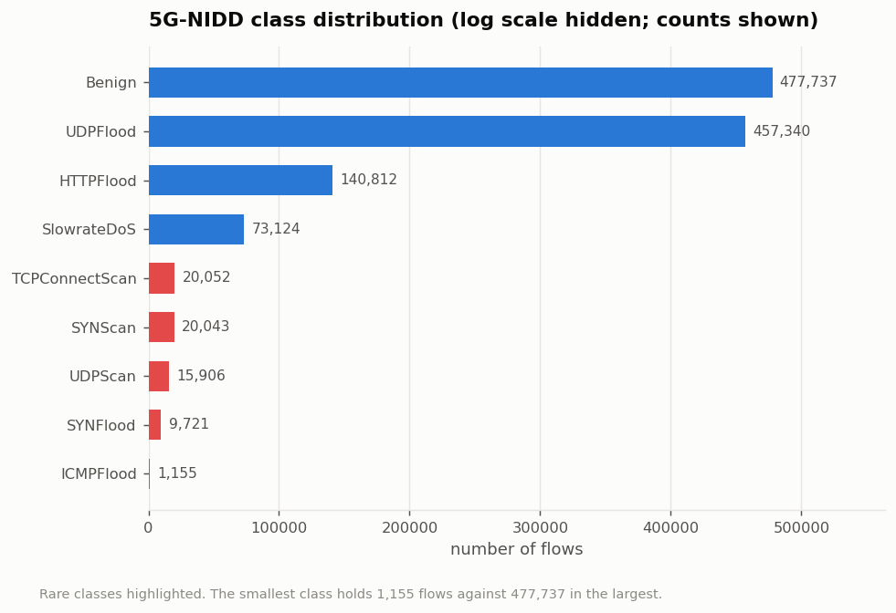
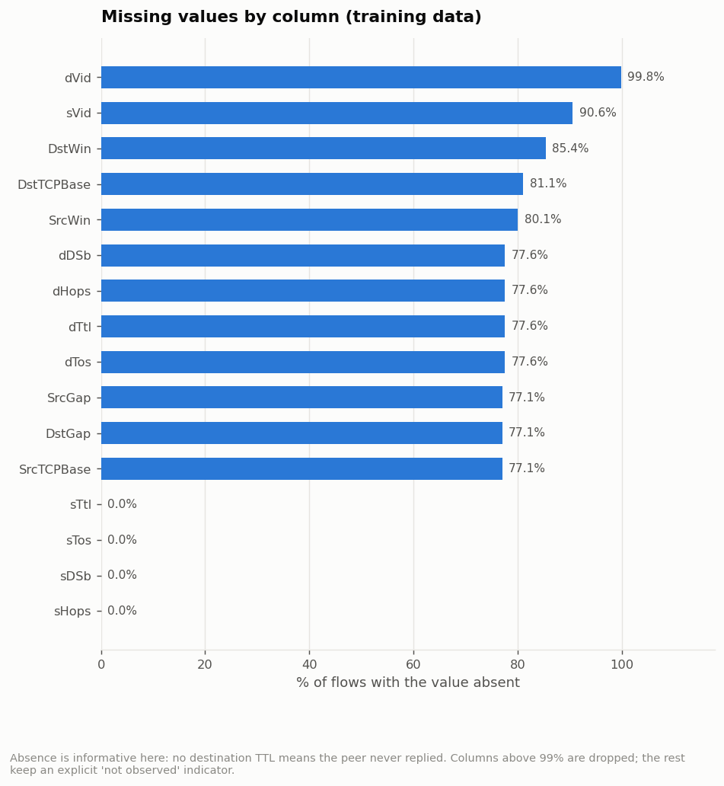
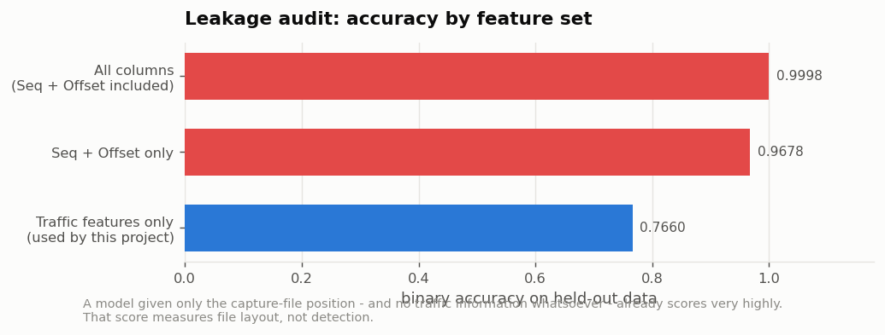
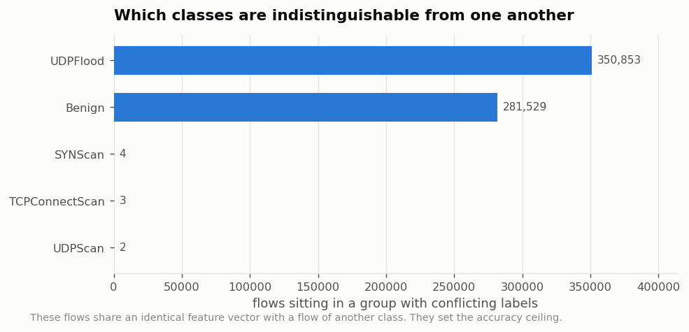
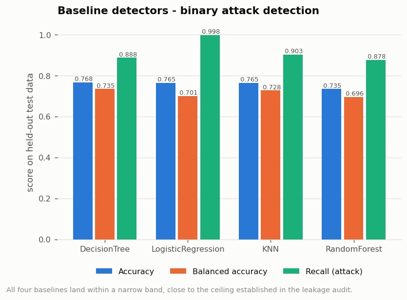
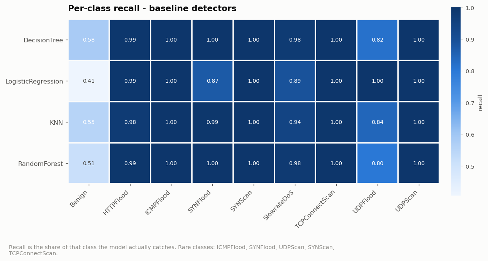
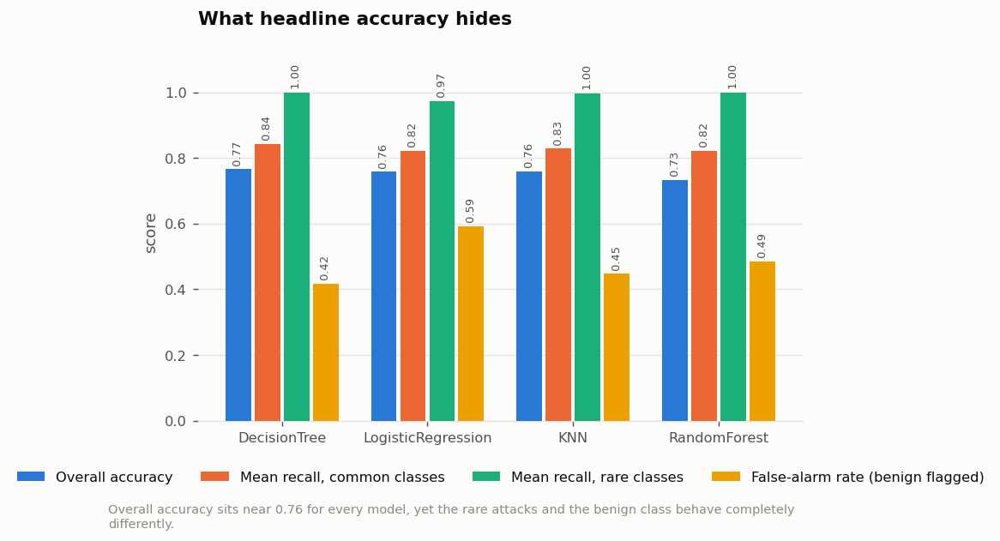

# Research Objective 1 - Results

**Objective.** Prepare and profile the 5G-NIDD dataset and build baseline detectors, reporting both overall accuracy and the detection rate of the rare attack classes to expose the minority-class gap.

| | |
|---|---|
| Run profile | `full` (1,215,890 (all) flows sampled from 5G-NIDD) |
| Generated | 2026-08-02 13:21:22 |
| Dataset | 5G-NIDD `Combined.csv` (1,215,890 flows x 52 columns) |
| Random seed | 42 (fixed; the run is reproducible) |

> This file is generated by the pipeline. Every number in it was produced by the run whose timestamp appears above - nothing is transcribed by hand.

---

## 1a. Dataset preparation and profiling

### What was produced

- [`01_class_distribution.csv`](raw_results/01_class_distribution.csv) - flows and percentage share of each of the 9 attack classes
- [`02_missing_values.csv`](raw_results/02_missing_values.csv) - percentage of missing values per column
- [`03_leakage_audit.json`](raw_results/03_leakage_audit.json) - accuracy reachable from each feature set, with and without the capture-order columns
- [`04_removed_columns.csv`](raw_results/04_removed_columns.csv) - every column removed before modelling and the reason for it
- [`05_feature_list.csv`](raw_results/05_feature_list.csv) - the final feature list with each feature's type
- [`06_accuracy_ceiling.json`](raw_results/06_accuracy_ceiling.json) - the highest accuracy any model can reach on these features

### Class distribution

The dataset carries a binary label (`Label`) and a 9-class label (`Attack Type`).

| Quantity | Measured value |
|---|---|
| Flows analysed | 1,215,890 |
| Benign flows | 477,737 |
| Malicious flows | 738,153 |
| Attack classes | 8 |
| Largest class | Benign (39.29%) |
| Smallest class | ICMPFlood (0.095%) |
| Imbalance ratio | 414 : 1 |

| class | flows | share_% | is_minority |
| --- | --- | --- | --- |
| Benign | 477,737 | 39.291 | False |
| UDPFlood | 457,340 | 37.614 | False |
| HTTPFlood | 140,812 | 11.581 | False |
| SlowrateDoS | 73,124 | 6.014 | False |
| TCPConnectScan | 20,052 | 1.649 | True |
| SYNScan | 20,043 | 1.648 | True |
| UDPScan | 15,906 | 1.308 | True |
| SYNFlood | 9,721 | 0.799 | True |
| ICMPFlood | 1,155 | 0.095 | True |

*Figure: Flows per class. The five rare classes are highlighted.*

The rare classes - ICMPFlood, SYNFlood, UDPScan, SYNScan, TCPConnectScan - together account for a
small fraction of the data but are the reconnaissance and low-volume signals
that matter operationally. An overall accuracy figure can be high while every
one of them is missed, which is why this objective reports per-class recall
separately.

### Missing values

16 of the 52 columns contain missing values.

*Figure: Missing-value rate by column.*

Missingness here is informative rather than accidental: a flow with no
destination TTL is one the peer never answered. Two columns (`sVid`, `dVid`)
are missing in over 99% of flows and are dropped; for the remainder the value
is filled with the training-set median **and** an explicit
`<column>__not_observed` flag is added, so the model can use the fact that the
value was absent.

### Leakage audit

| Feature set | Binary accuracy |
|---|---|
| Accuracy using all 48 columns | 0.9998 |
| Accuracy using ONLY Seq and Offset | 0.9678 |
| Accuracy using traffic features only | 0.7660 |
| Accuracy attributable to leakage | 0.2338 |

*Figure: Accuracy reachable from each feature set.*

`Seq` (the Argus record sequence number) and `Offset` (the byte offset inside
the capture file) describe *where a record sits in the file*, not what the
traffic did. `Combined.csv` was built by concatenating separate benign and
per-attack captures, so position within the file is a near-perfect proxy for
the label. Both columns are removed from every model in this project.

### Attainable accuracy ceiling

| Quantity | Measured value |
|---|---|
| Highest reachable binary accuracy | 0.7685 |
| Highest reachable 9-class accuracy | 0.7685 |
| Irreducible error | 0.2315 |
| Distinct feature vectors | 374,933 |
| Flows in label-conflicting groups | 632,382 |
| Share of flows in conflicting groups | 52.01% |

Classes most affected: UDPFlood (350,853 flows), Benign (281,529 flows), SYNScan (4 flows), TCPConnectScan (3 flows).

*Figure: Flows sitting in identical-feature groups with conflicting labels.*

### Prepared split

| Quantity | Value |
|---|---|
| Features used | 53 |
| Numeric features | 39 |
| Categorical features | 5 |
| 'Not observed' indicator features | 9 |
| Training flows | 729,534 |
| Validation flows | 243,178 |
| Test flows | 243,178 |
| Split | 60 / 20 / 20, stratified on the 9-class label |
| Random seed | 42 |

## 1b. Baseline detectors

### What was produced

- [`10_baselines_binary.csv`](raw_results/10_baselines_binary.csv) - binary results for all four baselines
- [`11_baselines_multiclass.csv`](raw_results/11_baselines_multiclass.csv) - 9-class results for all four baselines
- [`12_minority_gap.csv`](raw_results/12_minority_gap.csv) - common-class vs rare-class recall, per model
- [`13_per_class_recall.csv`](raw_results/13_per_class_recall.csv) - precision, recall and F1 for every model and every class

### Binary detection (attack vs benign)

| model | family | accuracy | balanced_accuracy | recall_attack | f1_attack | roc_auc | train_seconds |
| --- | --- | --- | --- | --- | --- | --- | --- |
| DecisionTree | glass-box (readable, baseline) | 0.7680 | 0.7354 | 0.8877 | 0.8229 | 0.8747 | 18.8600 |
| LogisticRegression | glass-box (readable, baseline) | 0.7649 | 0.7013 | 0.9983 | 0.8376 | 0.8284 | 21.1100 |
| KNN | black-box (instance-based) | 0.7654 | 0.7279 | 0.9030 | 0.8237 | 0.8626 | 0.7300 |
| RandomForest | black-box | 0.7349 | 0.6960 | 0.8777 | 0.8008 | 0.8417 | 132.4700 |

*Figure: Binary results for the four baseline detectors.*

Best binary accuracy: **DecisionTree at 0.7680**.

### 9-class attack-type classification

| model | accuracy | balanced_accuracy | macro_f1 | weighted_f1 | minority_macro_recall | mcc | train_seconds |
| --- | --- | --- | --- | --- | --- | --- | --- |
| DecisionTree | 0.7658 | 0.9299 | 0.9288 | 0.7628 | 0.9992 | 0.6685 | 9.0600 |
| LogisticRegression | 0.7584 | 0.9062 | 0.8990 | 0.7364 | 0.9732 | 0.7072 | 57.5100 |
| KNN | 0.7590 | 0.9219 | 0.9189 | 0.7542 | 0.9966 | 0.6631 | 0.4200 |
| RandomForest | 0.7328 | 0.9205 | 0.9187 | 0.7275 | 0.9990 | 0.6242 | 51.0600 |

Best macro-F1: **DecisionTree at 0.9288**.

### The minority-class gap

| model | mean_recall_common | mean_recall_rare | gap | worst_class_recall | worst_class | false_alarm_rate |
| --- | --- | --- | --- | --- | --- | --- |
| DecisionTree | 0.8432 | 0.9992 | -0.1560 | 0.5830 | Benign | 0.4170 |
| LogisticRegression | 0.8226 | 0.9732 | -0.1507 | 0.4072 | Benign | 0.5928 |
| KNN | 0.8286 | 0.9966 | -0.1680 | 0.5529 | Benign | 0.4471 |
| RandomForest | 0.8224 | 0.9990 | -0.1766 | 0.5144 | Benign | 0.4856 |

*Figure: Per-class recall for every baseline detector.*

*Figure: Overall accuracy, common-class recall, rare-class recall and false-alarm rate side by side.*

Measured across the four baselines:

- mean recall on the **common** classes: 0.8292
- mean recall on the **rare** classes: 0.9920
- gap (common minus rare): -0.1628
- worst single class for every model: **Benign**
- highest false-alarm rate: **LogisticRegression** at 0.5928

### Full per-class breakdown

| model | class | support | recall | precision | f1 | is_minority |
| --- | --- | --- | --- | --- | --- | --- |
| DecisionTree | Benign | 95547 | 0.5830 | 0.7707 | 0.6639 | False |
| DecisionTree | HTTPFlood | 28163 | 0.9927 | 0.9888 | 0.9908 | False |
| DecisionTree | ICMPFlood | 231 | 1.0000 | 1.0000 | 1.0000 | True |
| DecisionTree | SYNFlood | 1944 | 1.0000 | 0.9995 | 0.9997 | True |
| DecisionTree | SYNScan | 4008 | 0.9980 | 0.9985 | 0.9983 | True |
| DecisionTree | SlowrateDoS | 14625 | 0.9785 | 0.9859 | 0.9822 | False |
| DecisionTree | TCPConnectScan | 4011 | 0.9995 | 0.9990 | 0.9993 | True |
| DecisionTree | UDPFlood | 91468 | 0.8188 | 0.6528 | 0.7264 | False |
| DecisionTree | UDPScan | 3181 | 0.9987 | 0.9981 | 0.9984 | True |
| LogisticRegression | Benign | 95547 | 0.4072 | 0.9989 | 0.5785 | False |
| LogisticRegression | HTTPFlood | 28163 | 0.9912 | 0.9425 | 0.9662 | False |
| LogisticRegression | ICMPFlood | 231 | 1.0000 | 0.9390 | 0.9686 | True |
| LogisticRegression | SYNFlood | 1944 | 0.8735 | 0.9843 | 0.9256 | True |
| LogisticRegression | SYNScan | 4008 | 0.9988 | 0.9975 | 0.9981 | True |
| LogisticRegression | SlowrateDoS | 14625 | 0.8918 | 0.9612 | 0.9252 | False |
| LogisticRegression | TCPConnectScan | 4011 | 0.9973 | 0.9374 | 0.9664 | True |
| LogisticRegression | UDPFlood | 91468 | 1.0000 | 0.6196 | 0.7651 | False |
| LogisticRegression | UDPScan | 3181 | 0.9965 | 0.9984 | 0.9975 | True |
| KNN | Benign | 95547 | 0.5529 | 0.7867 | 0.6494 | False |
| KNN | HTTPFlood | 28163 | 0.9754 | 0.9687 | 0.9720 | False |
| KNN | ICMPFlood | 231 | 1.0000 | 0.9788 | 0.9893 | True |
| KNN | SYNFlood | 1944 | 0.9949 | 0.9918 | 0.9933 | True |
| KNN | SYNScan | 4008 | 0.9965 | 0.9990 | 0.9978 | True |
| KNN | SlowrateDoS | 14625 | 0.9421 | 0.9511 | 0.9466 | False |
| KNN | TCPConnectScan | 4011 | 0.9953 | 0.9916 | 0.9934 | True |
| KNN | UDPFlood | 91468 | 0.8438 | 0.6442 | 0.7306 | False |
| KNN | UDPScan | 3181 | 0.9962 | 1.0000 | 0.9981 | True |
| RandomForest | Benign | 95547 | 0.5144 | 0.7313 | 0.6039 | False |
| RandomForest | HTTPFlood | 28163 | 0.9931 | 0.9895 | 0.9913 | False |
| RandomForest | ICMPFlood | 231 | 1.0000 | 1.0000 | 1.0000 | True |
| RandomForest | SYNFlood | 1944 | 1.0000 | 1.0000 | 1.0000 | True |
| RandomForest | SYNScan | 4008 | 0.9980 | 0.9985 | 0.9983 | True |
| RandomForest | SlowrateDoS | 14625 | 0.9797 | 0.9866 | 0.9832 | False |
| RandomForest | TCPConnectScan | 4011 | 0.9993 | 0.9990 | 0.9991 | True |
| RandomForest | UDPFlood | 91468 | 0.8025 | 0.6127 | 0.6949 | False |
| RandomForest | UDPScan | 3181 | 0.9978 | 0.9975 | 0.9976 | True |
