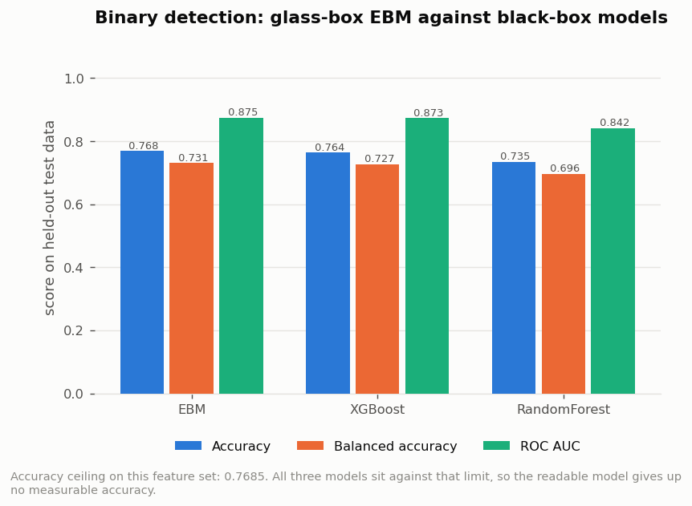
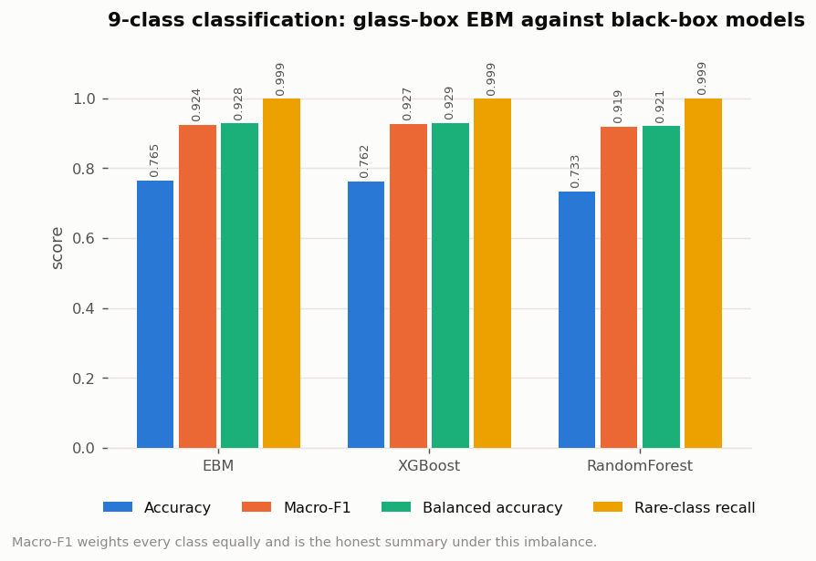
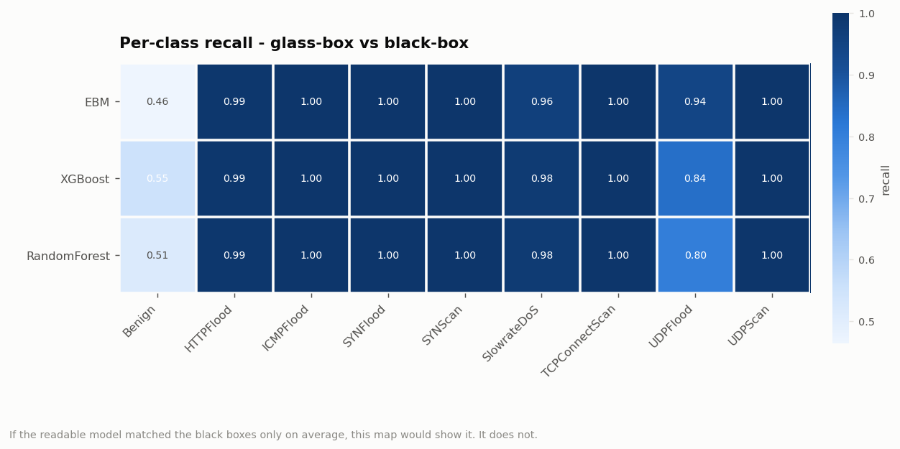
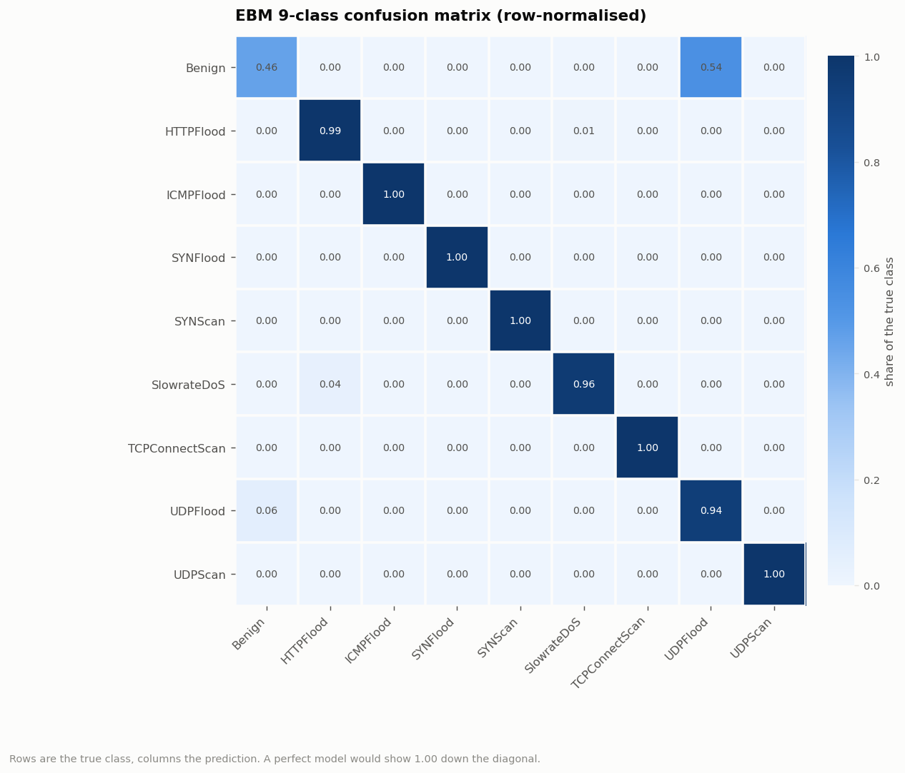
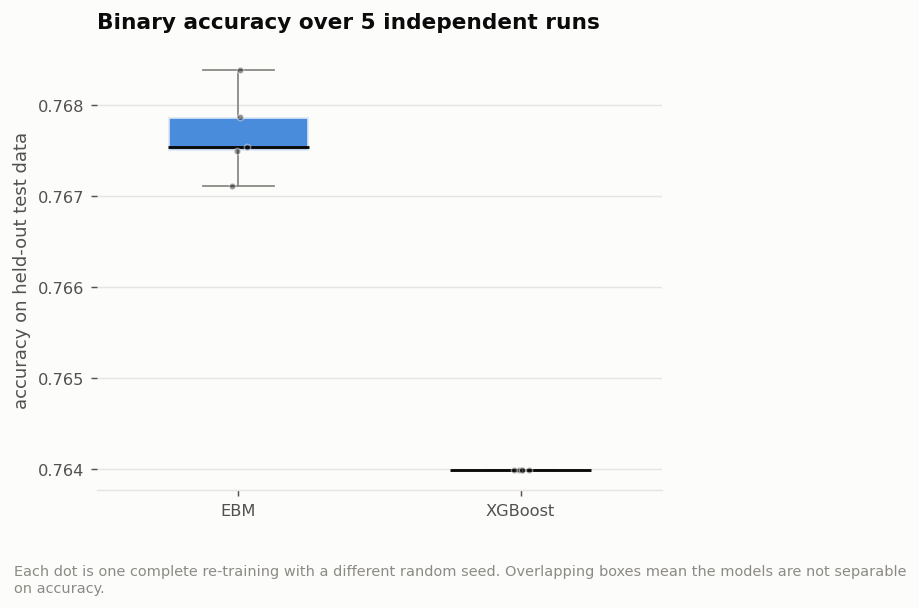
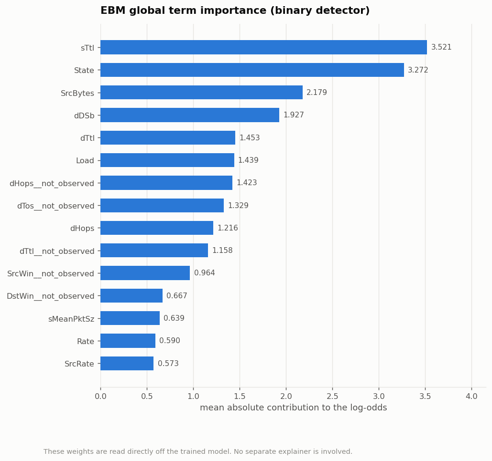

# Research Objective 2 - Results

**Objective.** Develop a glass-box detector (EBM) in stages - binary attack detection first, then the harder multiclass case with its severe imbalance - and measure its accuracy against black-box baselines.

| | |
|---|---|
| Run profile | `full` (1,215,890 (all) flows sampled from 5G-NIDD) |
| Generated | 2026-08-02 14:45:58 |
| Dataset | 5G-NIDD `Combined.csv` (1,215,890 flows x 52 columns) |
| Random seed | 42 (fixed; the run is reproducible) |

> This file is generated by the pipeline. Every number in it was produced by the run whose timestamp appears above - nothing is transcribed by hand.

---

## Glass-box detector (EBM) versus black-box models

### What was produced

- [`20_binary_comparison.csv`](raw_results/20_binary_comparison.csv) - binary results for EBM, XGBoost and random forest
- [`21_multiclass_comparison.csv`](raw_results/21_multiclass_comparison.csv) - 9-class results for the same three models
- [`22_multiclass_per_class.csv`](raw_results/22_multiclass_per_class.csv) - per-class precision, recall and F1 for all three models
- [`23_significance.json`](raw_results/23_significance.json) - accuracy over 5 independent re-trainings, with a paired t-test
- [`24_interpretability_audit.json`](raw_results/24_interpretability_audit.json) - what can be read out of each model
- [`25_ebm_global_importance.csv`](raw_results/25_ebm_global_importance.csv) - importance of every term in the EBM, read from the model itself

### Stage 1 - binary attack detection

| model | family | accuracy | balanced_accuracy | precision_attack | recall_attack | f1_attack | macro_f1 | mcc | roc_auc | train_seconds |
| --- | --- | --- | --- | --- | --- | --- | --- | --- | --- | --- |
| EBM | glass-box (intrinsically interpretable) | 0.7684 | 0.7308 | 0.7590 | 0.9062 | 0.8261 | 0.7397 | 0.5048 | 0.8747 | 242.4100 |
| XGBoost | black-box | 0.7640 | 0.7266 | 0.7566 | 0.9011 | 0.8226 | 0.7351 | 0.4946 | 0.8732 | 56.1100 |
| RandomForest | black-box | 0.7349 | 0.6960 | 0.7363 | 0.8777 | 0.8008 | 0.7024 | 0.4282 | 0.8417 | 168.1800 |

*Figure: Binary detection: glass-box against black-box.*

- EBM accuracy: **0.7684**
- Best black-box accuracy: **0.7640** (XGBoost)
- Difference: **+0.0044**
- Attainable ceiling on this feature set: **0.7685**
- Distance from EBM to the ceiling: **+0.0001**

### Stage 2 - 9-class attack-type classification

| model | accuracy | balanced_accuracy | macro_f1 | weighted_f1 | minority_macro_recall | mcc | train_seconds |
| --- | --- | --- | --- | --- | --- | --- | --- |
| EBM | 0.7647 | 0.9283 | 0.9241 | 0.7512 | 0.9986 | 0.6956 | 3929.6400 |
| XGBoost | 0.7621 | 0.9288 | 0.9271 | 0.7575 | 0.9986 | 0.6673 | 54.0300 |
| RandomForest | 0.7328 | 0.9205 | 0.9187 | 0.7275 | 0.9990 | 0.6242 | 63.9000 |

*Figure: 9-class classification: glass-box against black-box.*

*Figure: Per-class recall for all three models.*

*Figure: EBM 9-class confusion matrix.*

- EBM macro-F1: **0.9241**
- Best black-box macro-F1: **0.9271** (XGBoost)
- EBM rare-class recall: **0.9986**

### Repeated runs and significance

| model | mean_accuracy | std_dev | min | max |
| --- | --- | --- | --- | --- |
| EBM | 0.7677 | 0.0004 | 0.7671 | 0.7684 |
| XGBoost | 0.7640 | 0.0000 | 0.7640 | 0.7640 |

| Test | Value |
|---|---|
| Mean difference (EBM - XGBoost) | 0.0037 |
| Paired t-statistic | 17.3646 |
| p-value | 0.0001 |
| Runs per model | 5 |

**Verdict: Statistically significant at the 5% level (p=6.456e-05); the difference of +0.00370 accuracy is, however, practically negligible.**

*Figure: Accuracy across 5 independent re-trainings.*

### Interpretability audit

| Property | EBM (glass-box) | XGBoost (black-box) |
| --- | --- | --- |
| Readable components | 61 (53 curves + 8 pairwise) | 300 trees, ~12,574 split nodes |
| Explanation is the model | yes - exact | no - needs an explainer |
| Global explanation | read off the trained model | approximated post-hoc |
| Local explanation | exact term contributions, sum to the logit | SHAP estimate |
| Explanation depends on tool choice | no - only one exists | yes |
| Can a human audit the whole model | yes - 61 plots | no - 12,574 nodes |

### What the EBM actually learned

*Figure: The 15 most important EBM terms.*

| term | importance | kind | share_% | cumulative_% |
| --- | --- | --- | --- | --- |
| sTtl | 3.5211 | single feature | 11.8244 | 11.8244 |
| State | 3.2720 | single feature | 10.9879 | 22.8123 |
| SrcBytes | 2.1786 | single feature | 7.3163 | 30.1286 |
| dDSb | 1.9273 | single feature | 6.4721 | 36.6007 |
| dTtl | 1.4535 | single feature | 4.8810 | 41.4817 |
| Load | 1.4389 | single feature | 4.8321 | 46.3138 |
| dHops__not_observed | 1.4227 | single feature | 4.7775 | 51.0913 |
| dTos__not_observed | 1.3289 | single feature | 4.4628 | 55.5541 |
| dHops | 1.2161 | single feature | 4.0839 | 59.6379 |
| dTtl__not_observed | 1.1578 | single feature | 3.8879 | 63.5259 |
| SrcWin__not_observed | 0.9640 | single feature | 3.2373 | 66.7631 |
| DstWin__not_observed | 0.6667 | single feature | 2.2388 | 69.0020 |

The top 26 of 61 terms carry 90% of the total contribution.

Shape functions for the three strongest features are in the figures folder
(`26_shape_*.png`). Each one shows exactly how the model's opinion changes as
that feature changes.
