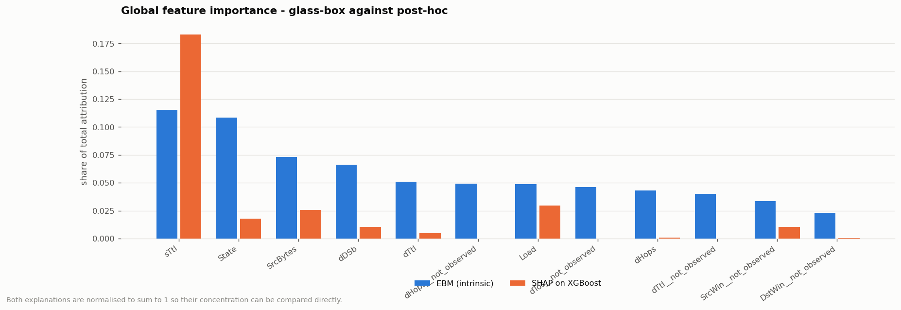
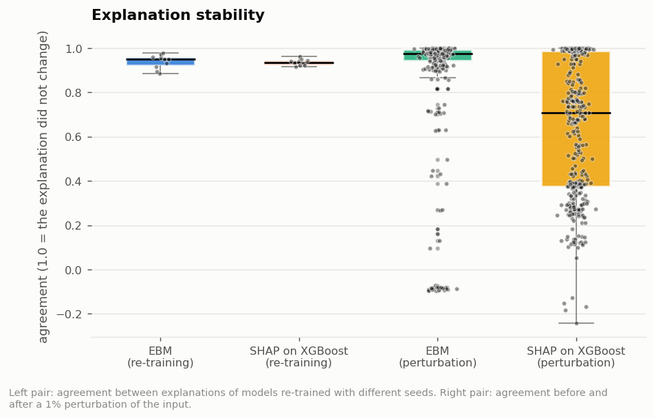
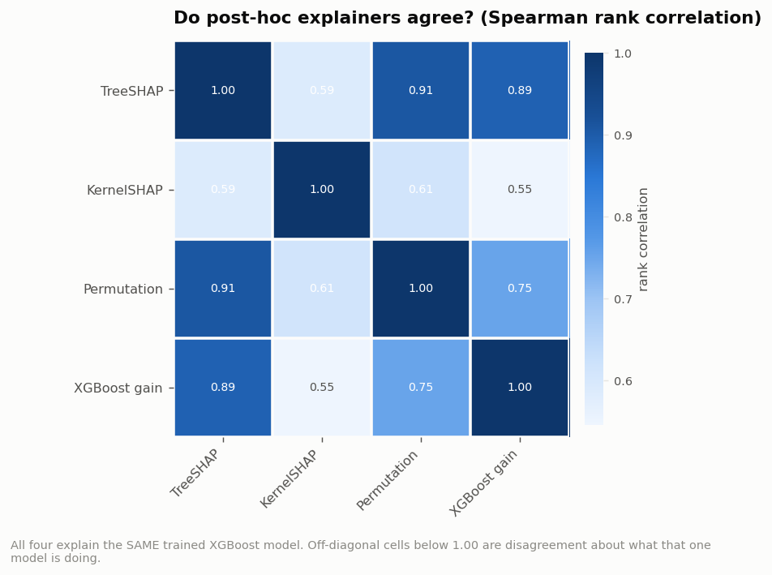
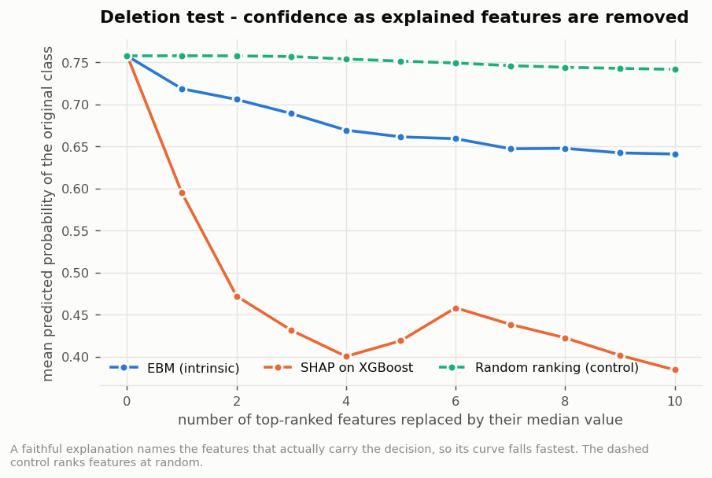
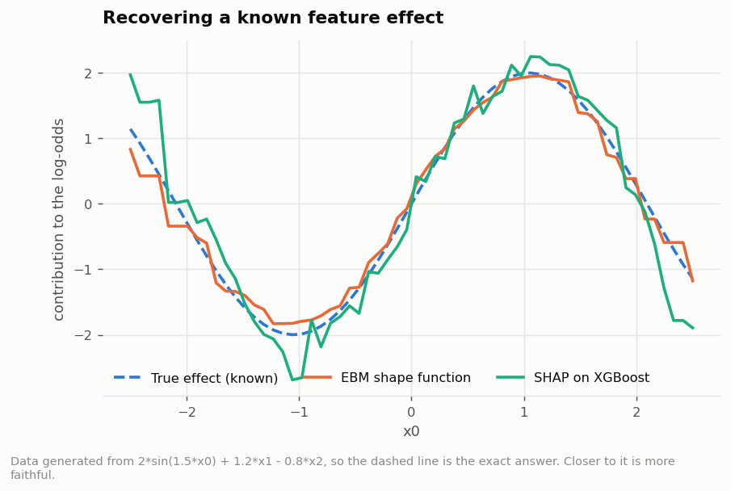

# Research Objective 3 - Results

**Objective.** Compare the EBM's intrinsic explanations with post-hoc SHAP explanations of an XGBoost model on identical splits, in terms of clarity, stability and faithfulness.

| | |
|---|---|
| Run profile | `full` (1,215,890 (all) flows sampled from 5G-NIDD) |
| Generated | 2026-08-02 14:56:42 |
| Dataset | 5G-NIDD `Combined.csv` (1,215,890 flows x 52 columns) |
| Random seed | 42 (fixed; the run is reproducible) |

> This file is generated by the pipeline. Every number in it was produced by the run whose timestamp appears above - nothing is transcribed by hand.

---

## Explanation quality: glass-box against post-hoc

### What was produced

- [`30_global_importance.csv`](raw_results/30_global_importance.csv) - global importance of every feature under both explanations
- [`31_clarity.json`](raw_results/31_clarity.json) - concentration measures for both explanations
- [`32_stability.csv`](raw_results/32_stability.csv) - re-training and perturbation stability
- [`33_explainer_agreement.json`](raw_results/33_explainer_agreement.json) - agreement between four post-hoc explainers of the same model
- [`34_faithfulness.json`](raw_results/34_faithfulness.json) - exactness, deletion curves and ground-truth recovery
- [`35_scorecard.csv`](raw_results/35_scorecard.csv) - the head-to-head scorecard

### 1. Clarity

| explanation | features_for_50pct | features_for_90pct | normalised_entropy | gini_concentration |
| --- | --- | --- | --- | --- |
| EBM (intrinsic) | 7 | 25 | 0.8228 | 0.6279 |
| SHAP on XGBoost | 4 | 13 | 0.6461 | 0.8149 |

*Figure: Global feature importance under both explanations.*

- EBM concentrates 90% of its attribution in **25** features.
- SHAP-on-XGBoost needs **13** features for the same 90%.

### 2. Stability

**2a. Across re-training (different random seed, same data):**

| explanation | mean_spearman | std_dev | mean_top5_jaccard |
| --- | --- | --- | --- |
| EBM | 0.9394 | 0.0300 | 0.5298 |
| SHAP | 0.9359 | 0.0133 | 0.8000 |

**2b. Under a 1% input perturbation:**

| explanation | mean_cosine_similarity | mean_top3_jaccard | top_reason_changed_pct |
| --- | --- | --- | --- |
| EBM | 0.8544 | 0.9113 | 15.7500 |
| SHAP | 0.6441 | 0.4928 | 54.2500 |

*Figure: Explanation stability under re-training and under input perturbation.*

**2c. Agreement between post-hoc explainers of the *same* XGBoost model:**

| pair | spearman | top5_jaccard |
| --- | --- | --- |
| TreeSHAP vs KernelSHAP | 0.5857 | 0.4286 |
| TreeSHAP vs Permutation | 0.9090 | 0.4286 |
| TreeSHAP vs XGBoost gain | 0.8889 | 0.6667 |
| KernelSHAP vs Permutation | 0.6118 | 0.1111 |
| KernelSHAP vs XGBoost gain | 0.5457 | 0.4286 |
| Permutation vs XGBoost gain | 0.7519 | 0.4286 |

*Figure: Rank correlation between four post-hoc explainers of one model.*

Worst-agreeing pair: **KernelSHAP vs XGBoost gain** at rho = 0.5457.
Mean off-diagonal agreement: 0.7155.

### 3. Faithfulness

**3a. Exactness of the additive decomposition:**

| explanation | max_abs_error | mean_abs_error | exact_by_construction |
| --- | --- | --- | --- |
| EBM (intrinsic) | 0.0000 | 0.0000 | yes - the model IS the sum of its terms |
| SHAP on XGBoost | 0.0000 | 0.0000 | only for TreeSHAP; other explainers of the same model differ |

**3b. Deletion test:**

| ranking | aopc | random_control_on_same_model | ratio_vs_own_control | confidence_after_0 | confidence_after_5 | confidence_after_10 |
| --- | --- | --- | --- | --- | --- | --- |
| EBM (intrinsic) | 0.0895 | 0.0075 | 11.8838 | 0.7577 | 0.6614 | 0.6410 |
| SHAP on XGBoost | 0.3164 | 0.0241 | 13.1326 | 0.7587 | 0.4189 | 0.3843 |
| Random ranking (control) | 0.0075 | 0.0075 | 1.0000 | 0.7577 | 0.7514 | 0.7416 |

*Figure: Model confidence as explanation-ranked features are removed.*

**3c. Recovery of a known effect:**

Data generated from `logit = 2*sin(1.5*x0) + 1.2*x1 - 0.8*x2` over 20,000 rows.

| Measure | Value |
|---|---|
| EBM RMSE against the true shape | 0.1734 |
| SHAP RMSE against the true shape | 0.4113 |
| EBM correlation with the truth | 0.9924 |
| SHAP correlation with the truth | 0.9680 |

*Figure: Both methods against a known generating function.*

### Scorecard

| property | measure | EBM (glass-box) | SHAP on XGBoost | better |
| --- | --- | --- | --- | --- |
| Clarity | features needed for 90% of the attribution | 25 | 13 | SHAP on XGBoost |
| Stability | rank agreement across re-trainings | 0.9394 | 0.9359 | EBM |
| Stability | similarity after a 1% input perturbation | 0.8544 | 0.6441 | EBM |
| Stability | explanations that disagree on this model | 1 (none possible) | 4 (worst rho=0.55) | EBM |
| Faithfulness | reconstruction error of the explanation | 2.49e-14 | 1.91e-05 | EBM |
| Faithfulness | deletion AOPC vs its own random control | 11.884 | 13.133 | SHAP on XGBoost |
| Faithfulness | error against a known ground-truth effect | 0.1734 | 0.4113 | EBM |

**EBM wins 5 of 7 measures;
SHAP-on-XGBoost wins 2; 0 are level.**
