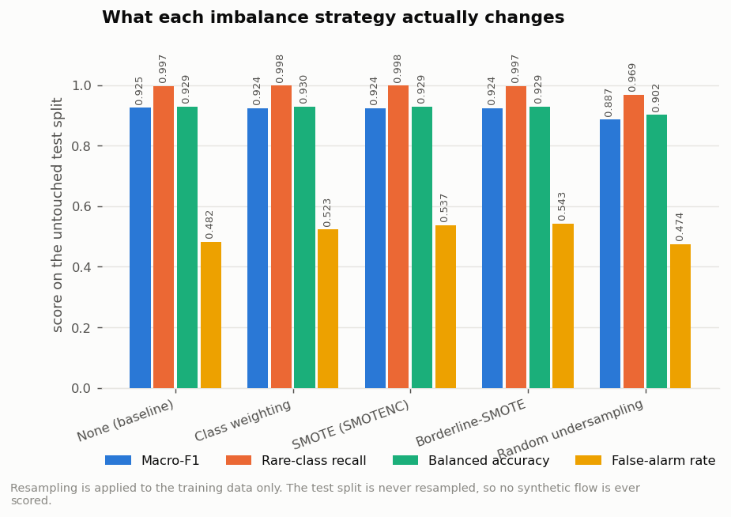
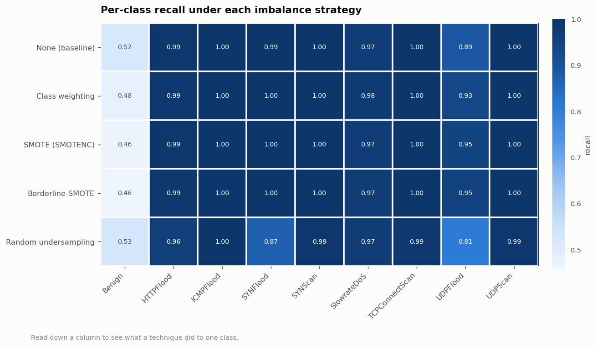
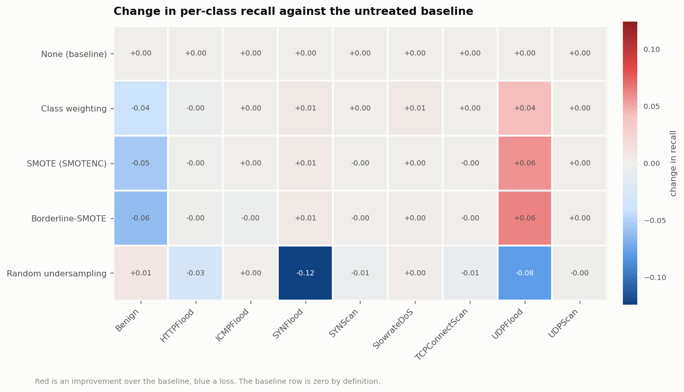
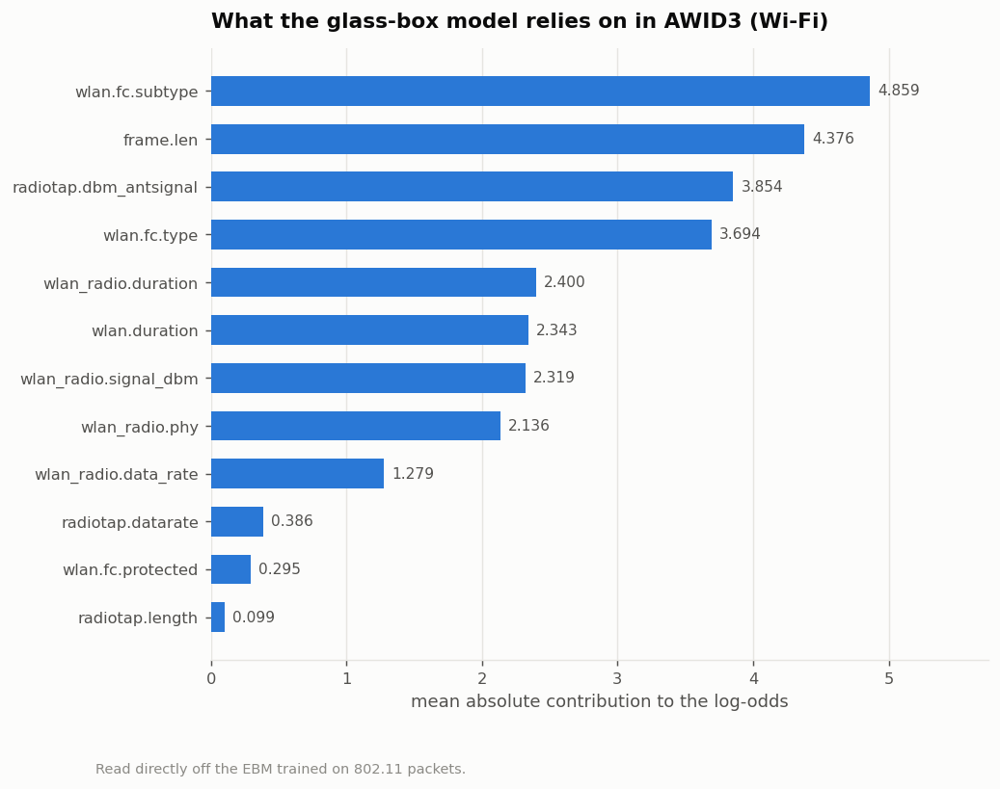
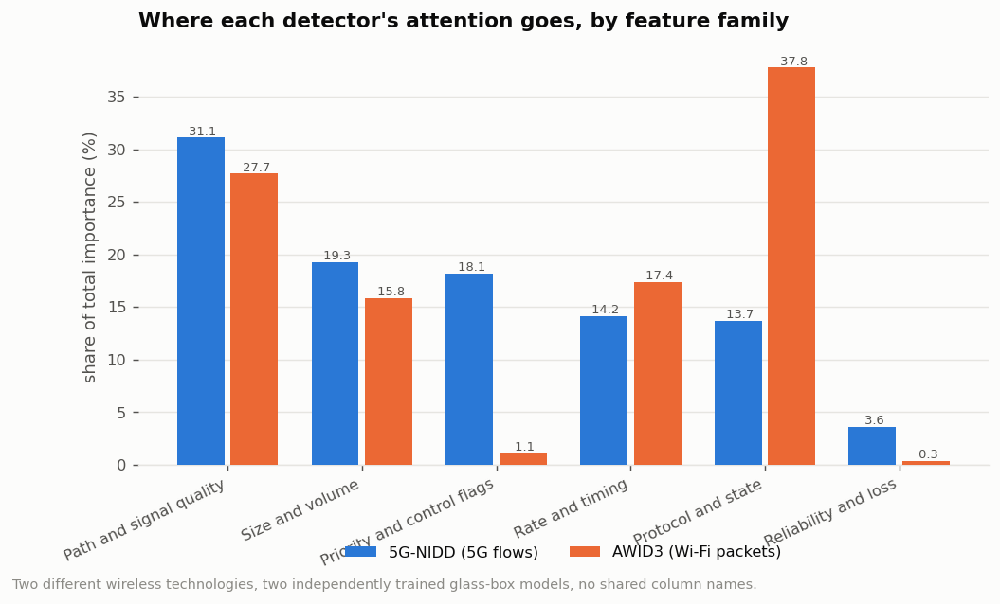
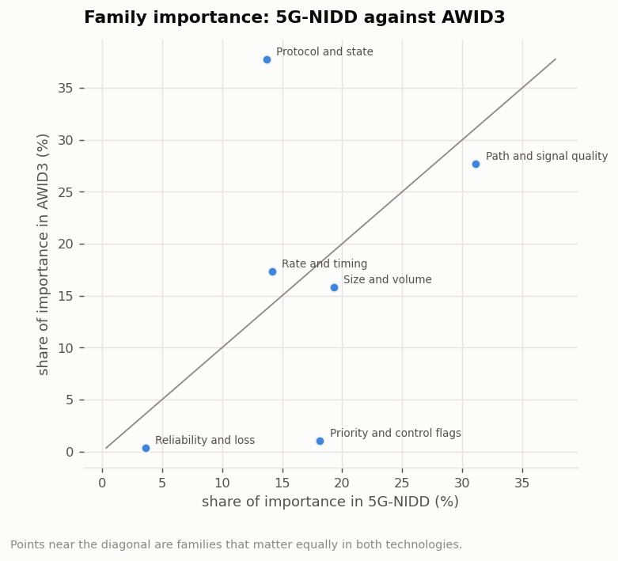

# Research Objective 4 - Results

**Objective.** Evaluate how imbalance-handling techniques affect minority-class recall, and run a generalisation probe on AWID3, examining whether the kinds of features the model relies on remain informative.

| | |
|---|---|
| Run profile | `full` (1,215,890 (all) flows sampled from 5G-NIDD) |
| Generated | 2026-08-02 15:00:55 |
| Dataset | 5G-NIDD `Combined.csv` (1,215,890 flows x 52 columns) |
| Random seed | 42 (fixed; the run is reproducible) |

> This file is generated by the pipeline. Every number in it was produced by the run whose timestamp appears above - nothing is transcribed by hand.

---

## 4a. Class-imbalance handling

### What was produced

- [`40_imbalance_sweep.csv`](raw_results/40_imbalance_sweep.csv) - every metric for every imbalance strategy
- [`41_change_vs_baseline.csv`](raw_results/41_change_vs_baseline.csv) - the same numbers as a change against the untreated baseline
- [`42_per_class_recall.csv`](raw_results/42_per_class_recall.csv) - per-class precision, recall and F1 under each strategy
- [`43_resampling_details.json`](raw_results/43_resampling_details.json) - how each technique altered the training set

### Setup

Every technique starts from an identical stratified training pool of
29,999 flows and is evaluated on the untouched test
split. Resampling is applied to the training data only - no synthetic flow is
ever scored.

> **Read these scores against each other, not against Objective 2.** This sweep
> fits five 9-class EBMs, some on resampled data three times the size, so it
> uses a reduced training budget
> (`outer_bags=4, learning_rate=0.1, max_rounds=1000`). That budget
> is applied identically to all five techniques, which is what makes the
> comparison between them valid - but it is smaller than the budget Objective 2
> uses, so the absolute macro-F1 here is lower than the headline figure and the
> two sections must not be compared directly.

Class counts in the training pool before treatment:

| class | flows |
| --- | --- |
| Benign | 11787 |
| UDPFlood | 11284 |
| HTTPFlood | 3474 |
| SlowrateDoS | 1804 |
| SYNScan | 495 |
| TCPConnectScan | 495 |
| UDPScan | 392 |
| SYNFlood | 240 |
| ICMPFlood | 28 |

### Results

| technique | training_rows | accuracy | macro_f1 | balanced_accuracy | minority_macro_recall | false_alarm_rate | train_seconds |
| --- | --- | --- | --- | --- | --- | --- | --- |
| None (baseline) | 29999 | 0.7665 | 0.9254 | 0.9286 | 0.9970 | 0.4821 | 15.4000 |
| Class weighting | 29999 | 0.7667 | 0.9243 | 0.9299 | 0.9983 | 0.5230 | 21.8000 |
| SMOTE (SMOTENC) | 106083 | 0.7665 | 0.9237 | 0.9295 | 0.9981 | 0.5370 | 69.2000 |
| Borderline-SMOTE | 94324 | 0.7657 | 0.9239 | 0.9290 | 0.9974 | 0.5435 | 53.6000 |
| Random undersampling | 252 | 0.7353 | 0.8865 | 0.9019 | 0.9686 | 0.4742 | 0.5000 |

*Figure: Each imbalance strategy across four metrics.*

### Change against the untreated baseline

| technique | training_rows | accuracy | macro_f1 | balanced_accuracy | minority_macro_recall | false_alarm_rate | train_seconds |
| --- | --- | --- | --- | --- | --- | --- | --- |
| None (baseline) | 29999 | 0.0000 | 0.0000 | 0.0000 | 0.0000 | 0.0000 | 15.4000 |
| Class weighting | 29999 | 0.0002 | -0.0012 | 0.0012 | 0.0014 | 0.0409 | 21.8000 |
| SMOTE (SMOTENC) | 106083 | 0.0000 | -0.0017 | 0.0008 | 0.0011 | 0.0549 | 69.2000 |
| Borderline-SMOTE | 94324 | -0.0008 | -0.0015 | 0.0003 | 0.0005 | 0.0614 | 53.6000 |
| Random undersampling | 252 | -0.0312 | -0.0389 | -0.0267 | -0.0284 | -0.0079 | 0.5000 |

*Figure: Per-class recall under each strategy.*

*Figure: Change in per-class recall against the baseline.*

### How each technique altered the training set

| technique | training_rows | what it does |
| --- | --- | --- |
| None (baseline) | 29999 | no treatment |
| Class weighting | 29999 | each flow weighted by the inverse frequency of its class; no rows added |
| SMOTE (SMOTENC) | 106083 | synthetic minority flows interpolated between each rare flow and its 5 nearest same-class neighbours; categorical features take the neighbours' most common value rather than being interpolated (SMOTENC) |
| Borderline-SMOTE | 94324 | as SMOTE, but only near the decision boundary where confusion actually happens; classes with no borderline examples are left untouched |
| Random undersampling | 252 | majority classes randomly cut down to the size of the smallest class |

### Headline

- Baseline rare-class recall: **0.9970**
- Best rare-class recall: **0.9983** (Class weighting)
- Best macro-F1: **0.9254** (None (baseline))
- Cost of the best rare-recall technique: false-alarm rate
  +0.0409, macro-F1
  -0.0012

## 4b. Generalisation probe on AWID3 (IEEE 802.11 Wi-Fi)

### What was produced

- [`44_awid3_detection.csv`](raw_results/44_awid3_detection.csv) - detection performance of the glass-box model on AWID3
- [`45_awid3_importance.csv`](raw_results/45_awid3_importance.csv) - what the AWID3 model relies on, feature by feature
- [`46_family_transfer.csv`](raw_results/46_family_transfer.csv) - importance by feature family in both datasets
- [`47_family_mapping.json`](raw_results/47_family_mapping.json) - the exact 5G-NIDD-to-AWID3 family mapping used

### The probe, and its limits

5G-NIDD contains Argus **flow** records from a 5G testbed. AWID3 contains
per-**packet** IEEE 802.11 records from a Wi-Fi testbed. The two share no
column names at all, so a feature-for-feature transfer is impossible and is not
attempted - this is a probe, exactly as the objective states.

What can be tested is whether the same *kinds* of measurement carry the signal.
Six feature families were defined, each mapping a group of 5G-NIDD columns and
a group of AWID3 columns onto one network concept. Identifier columns
(`frame.number`, timestamps, MAC addresses) were removed from AWID3 for the
same reason `Seq` and `Offset` were removed from 5G-NIDD in Objective 1.

### AWID3 subset

| Quantity | Value |
|---|---|
| Packets used | 256,168 |
| Normal | 186,282 |
| Attack | 69,886 |
| Attack families | 7 |
| Features after removing identifiers | 19 |

| class | packets |
| --- | --- |
| Normal | 186282 |
| Website_spoofing | 25295 |
| Disas | 18887 |
| Kr00k | 10807 |
| Malware | 9599 |
| Deauth | 2567 |
| Botnet | 1483 |
| SSH | 1248 |

### Does the glass-box approach work on Wi-Fi?

| Metric | Value |
|---|---|
| accuracy | 0.9860 |
| balanced_accuracy | 0.9868 |
| precision_attack | 0.9610 |
| recall_attack | 0.9886 |
| f1_attack | 0.9746 |
| macro_f1 | 0.9825 |
| mcc | 0.9651 |
| roc_auc | 0.9985 |

*Figure: What the glass-box model relies on in AWID3.*

### Do the same feature families matter?

| family | nidd_share_pct | awid_share_pct | nidd_rank | awid_rank | rank_diff | nidd_features_matched | awid_features_matched |
| --- | --- | --- | --- | --- | --- | --- | --- |
| Path and signal quality | 31.1000 | 27.6800 | 1 | 2 | 1 | 4 | 4 |
| Size and volume | 19.2800 | 15.8100 | 2 | 4 | 2 | 11 | 2 |
| Priority and control flags | 18.1500 | 1.0500 | 3 | 5 | 2 | 6 | 3 |
| Rate and timing | 14.1600 | 17.3700 | 4 | 3 | 1 | 12 | 4 |
| Protocol and state | 13.6900 | 37.7600 | 5 | 1 | 4 | 3 | 3 |
| Reliability and loss | 3.6100 | 0.3400 | 6 | 6 | 0 | 6 | 3 |

| Measure | Value |
|---|---|
| Spearman rank correlation of family importance | 0.2571 |
| p-value | 0.6228 |
| Top-3 family overlap | 1 of 3 |
| Families in both top threes | Path and signal quality |

*Figure: Share of each model's attention by feature family.*

*Figure: Family importance in 5G-NIDD against AWID3.*
