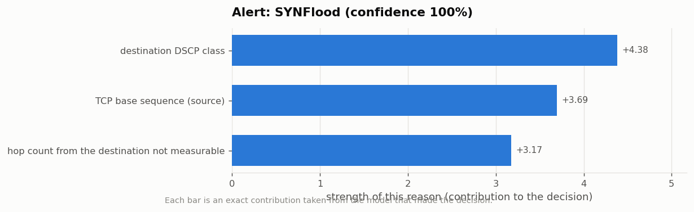
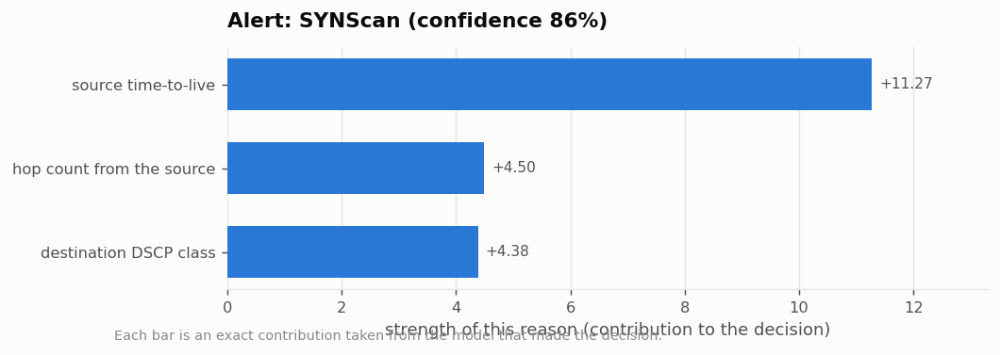
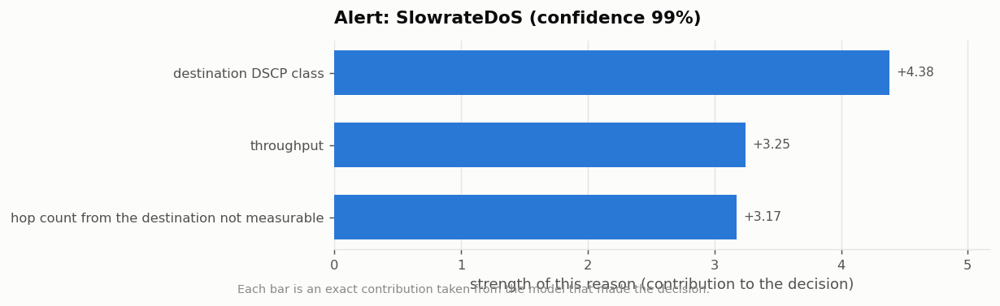
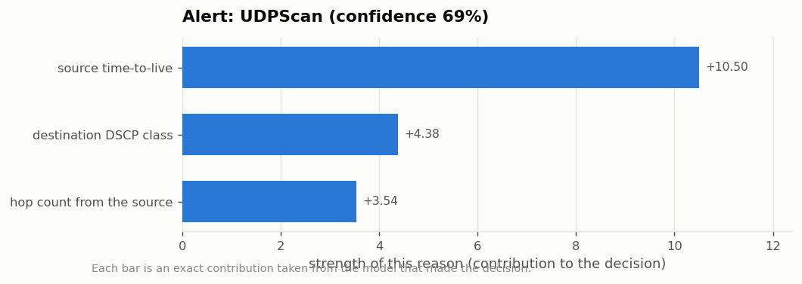
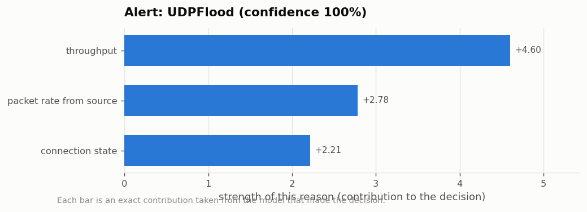
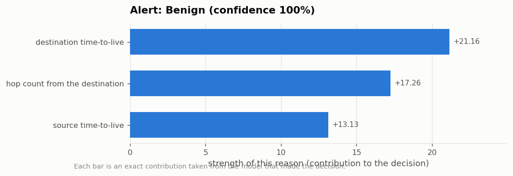

# Security Alerts - Explained

Each alert below was produced by the glass-box detector (Explainable Boosting Machine). The reasons are the model's own term contributions, not an after-the-fact estimate - which is why the audit line at the bottom of each card reconciles exactly.

_Generated from the `full` run. 8 alerts._

---

## Alert 1 - HTTPFlood

| | |
|---|---|
| **Verdict** | ATTACK |
| **Attack type** | HTTPFlood |
| **Confidence** | 99.5% |
| **Severity** | High |
| **Flow reference** | test row 105218 |

**What this is.** A denial-of-service flood of HTTP requests designed to overwhelm a web service.

**Why the detector says so:**

1. The destination DSCP class is cs0, whereas normal traffic usually shows 'not-observed'. This pushes the decision towards an attack.  
   *(destination DSCP class = cs0; quality-of-service class in replies; strength +4.38)*
2. The throughput is 4,559 bits/s, in the top 8% for normal traffic (typical: 0 bits/s). This pushes the decision towards an attack.  
   *(throughput = 4,559 bits/s; overall data rate of the flow; strength +3.19)*
3. The hop count from the destination was recorded for this flow. This pushes the decision towards an attack.  
   *(hop count from the destination not measurable = no; there was no hop count from the destination to measure on this flow; strength +3.17)*

**Recommended first response.** Apply request rate-limiting for the source; check web server load and enable challenge/CAPTCHA if available.

> **Audit trail.** Sum of the model's own terms = `39.218`; the model's actual output = `39.218`. They match because the explanation is the model.

---

## Alert 2 - ICMPFlood

| | |
|---|---|
| **Verdict** | ATTACK |
| **Attack type** | ICMPFlood |
| **Confidence** | 100.0% |
| **Severity** | High |
| **Flow reference** | test row 224365 |

**What this is.** A flood of ICMP (ping) traffic used to saturate the link.

**Why the detector says so:**

1. The destination DSCP class is cs0, whereas normal traffic usually shows 'not-observed'. This pushes the decision towards an attack.  
   *(destination DSCP class = cs0; quality-of-service class in replies; strength +4.38)*
2. The packet rate is 453.1 packets/s, higher than 99.2% of normal traffic. This pushes the decision towards an attack.  
   *(packet rate = 453.1 packets/s; how fast packets were sent overall; strength +3.21)*
3. The hop count from the destination was recorded for this flow. This pushes the decision towards an attack.  
   *(hop count from the destination not measurable = no; there was no hop count from the destination to measure on this flow; strength +3.17)*

**Recommended first response.** Rate-limit ICMP at the gateway; confirm no diagnostic tooling is responsible before blocking.

> **Audit trail.** Sum of the model's own terms = `17.7067`; the model's actual output = `17.7067`. They match because the explanation is the model.

---

## Alert 3 - SYNFlood

| | |
|---|---|
| **Verdict** | ATTACK |
| **Attack type** | SYNFlood |
| **Confidence** | 99.8% |
| **Severity** | High |
| **Flow reference** | test row 85980 |

**What this is.** A TCP SYN flood: half-open connections opened faster than the target can close them.

**Why the detector says so:**

1. The destination DSCP class is cs0, whereas normal traffic usually shows 'not-observed'. This pushes the decision towards an attack.  
   *(destination DSCP class = cs0; quality-of-service class in replies; strength +4.38)*
2. The TCP base sequence (source) is 1,150,275,712, lower than 99.1% of normal traffic. This pushes the decision towards an attack.  
   *(TCP base sequence (source) = 1,150,275,712; initial TCP sequence number from the initiator; strength +3.69)*
3. The hop count from the destination was recorded for this flow. This pushes the decision towards an attack.  
   *(hop count from the destination not measurable = no; there was no hop count from the destination to measure on this flow; strength +3.17)*

**Recommended first response.** Enable SYN cookies on the target host and rate-limit new connections from the source.

> **Audit trail.** Sum of the model's own terms = `27.8311`; the model's actual output = `27.8311`. They match because the explanation is the model.

---

## Alert 4 - SYNScan

| | |
|---|---|
| **Verdict** | ATTACK |
| **Attack type** | SYNScan |
| **Confidence** | 86.2% |
| **Severity** | Medium - reconnaissance |
| **Flow reference** | test row 137164 |

**What this is.** Reconnaissance. TCP SYN probes used to map which ports are open.

**Why the detector says so:**

1. The source time-to-live is 37 hops, lower than virtually all normal traffic. This pushes the decision towards an attack.  
   *(source time-to-live = 37 hops; remaining hop budget on packets from the sender; strength +11.27)*
2. The hop count from the source is 27 hops, higher than virtually all normal traffic. This pushes the decision towards an attack.  
   *(hop count from the source = 27 hops; estimated router hops travelled from the sender; strength +4.50)*
3. The destination DSCP class is cs0, whereas normal traffic usually shows 'not-observed'. This pushes the decision towards an attack.  
   *(destination DSCP class = cs0; quality-of-service class in replies; strength +4.38)*

**Recommended first response.** Log and monitor the source. Scanning usually precedes an attack; review what it found exposed.

> **Audit trail.** Sum of the model's own terms = `32.3933`; the model's actual output = `32.3933`. They match because the explanation is the model.

---

## Alert 5 - SlowrateDoS

| | |
|---|---|
| **Verdict** | ATTACK |
| **Attack type** | SlowrateDoS |
| **Confidence** | 99.4% |
| **Severity** | High |
| **Flow reference** | test row 39494 |

**What this is.** A slow-rate denial-of-service attack that holds connections open to exhaust the server's connection pool.

**Why the detector says so:**

1. The destination DSCP class is cs0, whereas normal traffic usually shows 'not-observed'. This pushes the decision towards an attack.  
   *(destination DSCP class = cs0; quality-of-service class in replies; strength +4.38)*
2. The throughput is 1,058 bits/s, in the top 8% for normal traffic (typical: 0 bits/s). This pushes the decision towards an attack.  
   *(throughput = 1,058 bits/s; overall data rate of the flow; strength +3.25)*
3. The hop count from the destination was recorded for this flow. This pushes the decision towards an attack.  
   *(hop count from the destination not measurable = no; there was no hop count from the destination to measure on this flow; strength +3.17)*

**Recommended first response.** Reduce the connection timeout on the target service and cap concurrent connections per source address.

> **Audit trail.** Sum of the model's own terms = `37.081`; the model's actual output = `37.081`. They match because the explanation is the model.

---

## Alert 6 - UDPScan

| | |
|---|---|
| **Verdict** | ATTACK |
| **Attack type** | UDPScan |
| **Confidence** | 69.0% |
| **Severity** | Medium - reconnaissance |
| **Flow reference** | test row 215847 |

**What this is.** Reconnaissance. UDP probes used to discover open UDP services.

**Why the detector says so:**

1. The source time-to-live is 43 hops, lower than virtually all normal traffic. This pushes the decision towards an attack.  
   *(source time-to-live = 43 hops; remaining hop budget on packets from the sender; strength +10.50)*
2. The destination DSCP class is cs0, whereas normal traffic usually shows 'not-observed'. This pushes the decision towards an attack.  
   *(destination DSCP class = cs0; quality-of-service class in replies; strength +4.38)*
3. The hop count from the source is 21 hops, higher than virtually all normal traffic. This pushes the decision towards an attack.  
   *(hop count from the source = 21 hops; estimated router hops travelled from the sender; strength +3.54)*

**Recommended first response.** Log and monitor the source; review exposed UDP services.

> **Audit trail.** Sum of the model's own terms = `30.194`; the model's actual output = `30.194`. They match because the explanation is the model.

---

## Alert 7 - UDPFlood

| | |
|---|---|
| **Verdict** | ATTACK |
| **Attack type** | UDPFlood |
| **Confidence** | 100.0% |
| **Severity** | High |
| **Flow reference** | test row 179427 |

**What this is.** A denial-of-service flood of UDP packets aimed at exhausting bandwidth or server capacity.

**Why the detector says so:**

1. The throughput is 147 bits/s, in the top 9% for normal traffic (typical: 0 bits/s). This pushes the decision towards an attack.  
   *(throughput = 147 bits/s; overall data rate of the flow; strength +4.60)*
2. The packet rate from source is 0.4 packets/s, in the top 9% for normal traffic (typical: 0.0 packets/s). This pushes the decision towards an attack.  
   *(packet rate from source = 0.4 packets/s; sending rate of the initiator; strength +2.78)*
3. The connection state is INT, the same value normal traffic usually shows. This pushes the decision towards an attack.  
   *(connection state = INT; how the connection ended (established, reset, request only, ...); strength +2.21)*

**Recommended first response.** Rate-limit or block the source at the edge; verify the target service is still reachable for legitimate users.

> **Audit trail.** Sum of the model's own terms = `16.603`; the model's actual output = `16.603`. They match because the explanation is the model.

---

## Alert 8 - Benign

| | |
|---|---|
| **Verdict** | BENIGN |
| **Attack type** | Benign |
| **Confidence** | 100.0% |
| **Severity** | Informational |
| **Flow reference** | test row 83228 |

**What this is.** Normal traffic. No action required.

**Why the detector says so:**

1. The destination time-to-live is 255 hops, higher than virtually all normal traffic. This pushes the decision towards normal traffic.  
   *(destination time-to-live = 255 hops; remaining hop budget on replies; strength +21.16)*
2. The hop count from the destination is 1 hop, in the bottom 5% for normal traffic (typical: 5 hops). This pushes the decision towards normal traffic.  
   *(hop count from the destination = 1 hop; estimated router hops travelled from the peer; strength +17.26)*
3. The source time-to-live is 252 hops, in the top 1% for normal traffic (typical: 63 hops). This pushes the decision towards normal traffic.  
   *(source time-to-live = 252 hops; remaining hop budget on packets from the sender; strength +13.13)*

**Recommended first response.** None.

> **Audit trail.** Sum of the model's own terms = `-81.3882`; the model's actual output = `-81.3882`. They match because the explanation is the model.

---
