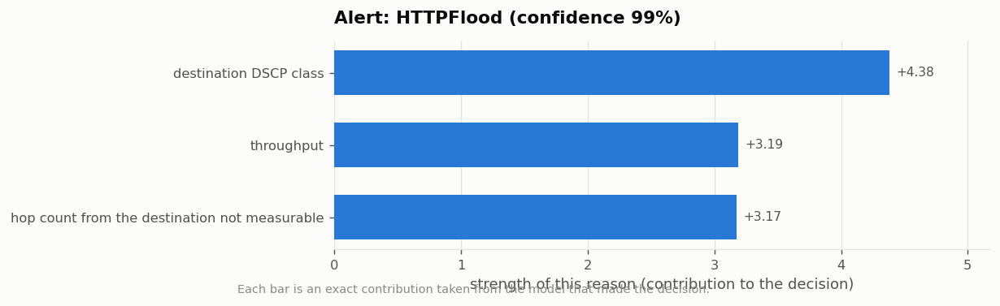

# Research Objective 5 - Results

**Objective.** Produce a simple, analyst-readable explanation output suitable for a non-expert decision-maker.

| | |
|---|---|
| Run profile | `full` (1,215,890 (all) flows sampled from 5G-NIDD) |
| Generated | 2026-08-02 15:00:56 |
| Dataset | 5G-NIDD `Combined.csv` (1,215,890 flows x 52 columns) |
| Random seed | 42 (fixed; the run is reproducible) |

> This file is generated by the pipeline. Every number in it was produced by the run whose timestamp appears above - nothing is transcribed by hand.

---

## Analyst-readable explanation output

### What was produced

- [`ALERT_CARDS.html`](ALERT_CARDS.html) - the alert cards as a browser page.
  **This is the file to show an analyst or a decision-maker.**
- [`ALERT_CARDS.md`](ALERT_CARDS.md) - the same cards in Markdown.
- [`50_alert_cards.csv`](raw_results/50_alert_cards.csv) - one row per alert with its plain-English reasons
- [`51_alert_cards_full.json`](raw_results/51_alert_cards_full.json) - the complete card data including exact term contributions
- [`52_readability.json`](raw_results/52_readability.json) - readability measurements of the generated text
- `figures/50_card_*.png` - a reason chart for each alert.

### Coverage

| Quantity | Value |
|---|---|
| Alerts generated | 8 |
| Attack types covered | 8 |
| Reasons stated per alert | 3 |
| Alerts where the detector was correct | 7 of 8 |

| alert | true_class | detector_says | confidence | severity | top_reason |
| --- | --- | --- | --- | --- | --- |
| 1 | HTTPFlood | HTTPFlood | 0.9947 | High | destination DSCP class |
| 2 | ICMPFlood | ICMPFlood | 0.9999 | High | destination DSCP class |
| 3 | SYNFlood | SYNFlood | 0.9980 | High | destination DSCP class |
| 4 | SYNScan | SYNScan | 0.8623 | Medium - reconnaissance | source time-to-live |
| 5 | SlowrateDoS | SlowrateDoS | 0.9943 | High | destination DSCP class |
| 6 | TCPConnectScan | UDPScan | 0.6897 | Medium - reconnaissance | source time-to-live |
| 7 | UDPFlood | UDPFlood | 1.0000 | High | throughput |
| 8 | Benign | Benign | 1.0000 | Informational | destination time-to-live |

### Example card

**Alert: HTTPFlood** - confidence 99.5%,
severity High.

*What this is.* A denial-of-service flood of HTTP requests designed to overwhelm a web service.

*Why the detector says so:*

1. The destination DSCP class is cs0, whereas normal traffic usually shows 'not-observed'. This pushes the decision towards an attack.
2. The throughput is 4,559 bits/s, in the top 8% for normal traffic (typical: 0 bits/s). This pushes the decision towards an attack.
3. The hop count from the destination was recorded for this flow. This pushes the decision towards an attack.

*Recommended first response.* Apply request rate-limiting for the source; check web server load and enable challenge/CAPTCHA if available.

*Audit trail.* Sum of the model's own terms =
`39.218`; the model's actual
output = `39.218`.

*Figure: The three reasons behind the first alert, with their exact strengths.*

### Readability

| Measure | Value |
|---|---|
| alerts | 8 |
| reasons_per_alert | 3 |
| mean_words_per_reason | 20.2083 |
| longest_reason_words | 26 |
| reasons_containing_model_jargon | 0 |
| cards_whose_reasons_reconstruct_the_decision_exactly | 8 |
| extra_tools_required_to_produce_these | 0 |
